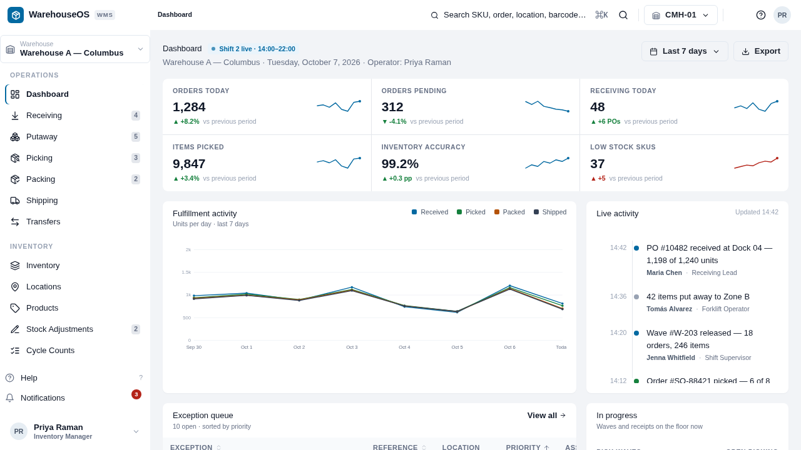

<p align="center">
  <span style="font-size: 48px;">📦</span>
  <br />
  <h1 align="center">WarehouseOS UI</h1>
  <p align="center">
    Warehouse management frontend — inbound, outbound, inventory &amp; admin workflows in one React SPA.
  </p>
  <p align="center">
    <a href="./license"></a>
    
    
    
    
    
  </p>
</p>

---

## Contents

- [Quick Start](#-quick-start)
- [Preview](#-preview)
- [Tech Stack](#-tech-stack)
- [Project Structure](#-project-structure)
- [Routes](#-routes)
- [Features](#-features)
- [Design System](#-design-system)
- [Notes](#-notes)
- [License](#-license)

---

## 🚀 Quick Start

```bash
npm install
npm run dev        # Vite dev server
npm run build      # tsc -b && vite build -> dist/
npm run preview    # Preview the production build
npm run typecheck  # tsc -b --pretty
```

> **Prerequisites:** Node + npm. No environment variables needed — `.env.example` is empty and nothing reads `import.meta.env`.

---
### Preview

<div align="center"> 
    
</div>
---

## 🛠 Tech Stack

| Layer            | Details                                                                                  |
| ---------------- | ---------------------------------------------------------------------------------------- |
| **Framework**    | React 19 · React Router DOM 6 · TypeScript ~6.0                                          |
| **Build**        | Vite 8 · `@vitejs/plugin-react` · `@tailwindcss/vite` · React Compiler (`@rolldown/plugin-babel`) |
| **Styling**      | Tailwind CSS v4 (`src/index.css` `@theme` tokens) · Chakra UI v2 (`src/theme.ts`) · Emotion |
| **Motion/Icons** | Framer Motion 11 · Lucide React                                                          |
| **Data**         | Local mock modules in `src/data/` — no backend wired up                                 |

---

## 📁 Project Structure

```
src/
├── main.tsx            # StrictMode + ChakraProvider + BrowserRouter + App
├── App.tsx             # Route table (AppShell layout + 404)
├── theme.ts            # Chakra extendTheme — accent palette, `wms` Table variant, sizes
├── index.css           # Tailwind v4 @theme tokens (app / ink / accent / status, 6/8px radii)
├── types.ts            # Domain types — orders, receipts, picks, counts, transfers, users…
│
├── pages/              # 25 pages (see Routes below)
│
├── components/
│   ├── shell/          # AppShell · Sidebar · Header · Breadcrumbs ·
│   │                   # CommandSearch · ShellWidgets
│   └── ui/             # DataTable · FilterBar · StatusBadge · Metric · Panel ·
│                       # PageHeader · Charts · ActivityTimeline · BarcodeScanner ·
│                       # ConfirmationDialog · DateRangePicker · LocationBreadcrumb ·
│                       # States · Toast
│
└── data/               # Mock datasets — inventory · locations · meta ·
                        # ops · orders · products · reports · users
```

Path alias: `@/` → `./src` (see `vite.config.ts`).

---

## 🗺 Routes

All routes render inside `<AppShell />`. Unknown paths show a `404` page with the unmatched pathname.

### Operations

| Path | Page | What lives there |
| ---- | ---- | ---------------- |
| `/` | Dashboard | KPIs, activity, exceptions |
| `/receiving` | Receiving | Receipts with line-level variance |
| `/putaway` | Putaway | Task queue (Queued → In Progress → Completed) |
| `/picking` | Picking | Pick waves |
| `/picking/workspace/:orderId` | PickerWorkspace | Per-order `PickLine` progress |
| `/packing` | Packing | Pack stations |
| `/shipping` | Shipping | Manifests, carriers, tracking |
| `/transfers` | Transfers | Draft → In Transit → Received |

### Inventory & Catalog

| Path | Page |
| ---- | ---- |
| `/inventory` | Inventory (Healthy / Low / Critical / Out) |
| `/products` | Products |
| `/products/:sku` | ProductDetail |
| `/locations` | Locations (bins & zones) |
| `/locations/:zone` | LocationsZone |

### Accuracy

| Path | Page |
| ---- | ---- |
| `/adjustments` | Adjustments (Pending Approval / Approved / Rejected) |
| `/cycle-counts` | CycleCounts |
| `/cycle-counts/:id` | CycleCountDetail (Scheduled → … → Completed) |

### Purchasing, Sales & Masters

| Path | Page |
| ---- | ---- |
| `/purchase-orders` | PurchaseOrders |
| `/purchase-orders/:id` | PurchaseOrderDetail |
| `/sales-orders` | SalesOrders |
| `/suppliers` | Suppliers (OTIF, lead time) |
| `/customers` | Customers (terms, credit hold) |
| `/users` | Users (roles, warehouses) |

### Insights & Admin

| Path | Page |
| ---- | ---- |
| `/reports` | Reports |
| `/performance` | Performance |
| `/settings` | Settings |

---

## ✨ Features

- **Inbound** — receiving receipts with expected / received / damaged / variance lines, putaway queues, purchase orders + detail view
- **Outbound** — pick waves, per-order picker workspace, packing, shipping manifests, sales-order pipeline (Received → … → Shipped)
- **Inventory** — stock by location, product catalog + detail, bin/zone browser, inter-warehouse transfers
- **Accuracy** — cycle counts with counted-vs-system lines, manual adjustments with approval flow
- **Masters** — suppliers, customers, users with search, filter and status management
- **Insights** — dashboard metrics, reports, performance charts, activity timeline
- **Shell** — sidebar nav, header, breadcrumbs, `⌘K`-style command search, notification / activity widgets
- **Shared UI kit** — typed `DataTable`, `FilterBar`, `StatusBadge` tones (`ok` / `warn` / `danger` / `info` / `neutral`), barcode scanner, confirm dialogs, toasts, loading & empty states

---

## 🎨 Design System

- **Mode:** light only (`initialColorMode: "light"`, `color-scheme: light`)
- **Accent:** single sky/navy `#0369a1` (Chakra `accent` scale + Tailwind `--color-accent*`)
- **Type:** 13px system stack, mono stack for code/numbers · `tabular-nums` on tables (`.tnum` utility)
- **Radii:** `6px` controls (`--radius-ctl`) · `8px` panels (`--radius-panel`)
- **Status (functional only):**

| Tone | Text | Bg | Line |
| ---- | ---- | -- | ---- |
| `ok` | `#15803d` | `#f0fdf4` | `#bbf7d0` |
| `warn` | `#b45309` | `#fffbeb` | `#fde68a` |
| `danger` | `#b42318` | `#fef3f2` | `#fecdca` |
| `neutral` | `#475467` | `#f8fafc` | `#e2e8f0` |

---

## 📝 Notes

- All data is static mock data in `src/data/` — no API client, fetch layer, or backend proxy exists in this repo.
- `.env.example` is empty; no env vars are consumed.
- `index.html` title: `WarehouseOS — WMS`.

---

## 📄 License

[MIT](./license)

<p align="center">
  <sub>Built with React 19 · Vite 8 · Tailwind v4 · Chakra UI</sub>
</p>
